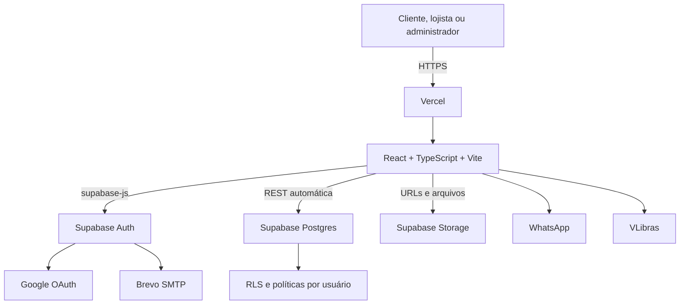

# Sebo Virtual - Documentação Completa do Projeto

Última atualização: 19 de novembro de 2026.

Este é o documento principal do Sebo Virtual. Ele reúne visão de produto, arquitetura, funcionalidades, banco de dados, segurança, autenticação, configuração, testes, publicação, roteiro de apresentação e respostas para perguntas do professor.

> Regra de segurança: este arquivo não contém senhas, chaves secretas, tokens administrativos ou credenciais da demonstração. Esses dados devem ser compartilhados apenas com o grupo, fora do GitHub.

## 1. Resumo do projeto

O Sebo Virtual é uma aplicação web que conecta leitores a sebos independentes. O leitor pesquisa livros usados em vários acervos, consulta informações do exemplar, salva desejos e entra em contato com o sebo pelo WhatsApp. O lojista cadastra seu estabelecimento e gerencia os livros somente depois de uma análise administrativa.

O projeto é um MVP de TCC. MVP significa Produto Mínimo Viável: uma versão funcional que implementa os fluxos principais e demonstra a viabilidade técnica da proposta.

### Links

- Produção: <https://sebo-virtual.vercel.app/>
- Repositório: <https://github.com/glp711/sebotek>
- Banco e autenticação: Supabase
- Hospedagem: Vercel

### Tecnologias principais

- React 19 para a interface.
- TypeScript para tipagem e prevenção de erros.
- Vite para desenvolvimento e build.
- Supabase Auth para autenticação.
- Supabase Postgres para persistência.
- Row Level Security para autorização no banco.
- Supabase Storage preparado para imagens.
- Brevo SMTP para entrega de e-mails.
- Google OAuth para login social.
- Vercel para hospedagem e deploy contínuo.
- Playwright para testes de interface.
- Lucide React para ícones.
- VLibras para apoio de acessibilidade em Libras.

## 2. Problema e proposta de solução

Muitos sebos pequenos não possuem catálogo digital organizado. O leitor precisa visitar lojas, procurar em redes sociais ou enviar mensagens para vários estabelecimentos sem saber se o livro está disponível.

O Sebo Virtual resolve esse problema ao centralizar os acervos em uma única busca. A proposta traz benefícios para os dois lados:

- O leitor encontra livros usados com mais rapidez.
- O sebo ganha uma vitrine digital sem precisar criar uma loja completa.
- O contato acontece diretamente entre leitor e estabelecimento.
- A administração verifica os sebos antes da publicação de produtos.
- O banco protege os dados de cada usuário com políticas de segurança.

## 3. Objetivos

### Objetivo geral

Desenvolver uma plataforma web que centralize catálogos de sebos independentes e facilite a descoberta de livros usados.

### Objetivos específicos

- Permitir busca por título, autor, categoria, ISBN e sebo.
- Exibir informações reais do exemplar, preço e estoque.
- Permitir contato direto por WhatsApp.
- Oferecer cadastro e login de clientes e lojistas.
- Permitir que clientes mantenham uma lista de desejos.
- Permitir CRUD de livros pelo responsável do sebo.
- Exigir aprovação administrativa antes da publicação do acervo.
- Proteger operações por usuário com RLS.
- Disponibilizar a aplicação em produção.
- Garantir funcionamento básico em desktop e celular.

## 4. Perfis do sistema

O banco possui três papéis em `profile_role`.

| Papel | Função | Principais permissões |
| --- | --- | --- |
| `CUSTOMER` | Cliente/leitor | Pesquisar, abrir livros, editar perfil e gerenciar a própria wishlist |
| `STORE_OWNER` | Responsável pelo sebo | Gerenciar o próprio sebo e o próprio acervo depois da aprovação |
| `ADMIN` | Administrador | Revisar cadastros e aprovar ou devolver sebos para análise |

O papel não é escolhido livremente no frontend. Um novo perfil começa como cliente. Ao cadastrar um sebo, o gatilho do banco altera o perfil para `STORE_OWNER`. O papel `ADMIN` deve ser atribuído de forma administrativa.

## 5. Funcionalidades implementadas

### Catálogo público

- Busca por título, autor, categoria, ISBN e nome do sebo.
- Busca tolerante a acentos, palavras parciais e ordem diferente.
- Filtros combináveis por categoria, conservação, sebo e preço máximo.
- Ordenação por recentes, menor preço, maior preço e título.
- Alternância entre visualização em grade e lista.
- Cards clicáveis com capa, autor, categoria, condição, preço e sebo.
- Detalhes com resumo, estoque, ISBN, editora, ano e endereço.
- Botão para contato pelo WhatsApp.
- Link individual e compartilhável para cada livro.
- Botão para copiar o link do exemplar.
- Navegação voltar/avançar preservando o estado da página.
- Modo de demonstração quando o Supabase não está configurado.

### Cliente

- Cadastro com e-mail e senha.
- Login com e-mail e senha.
- Login com Google.
- Confirmação de e-mail por código numérico.
- Interface aceita códigos entre 6 e 12 dígitos, incluindo códigos de 9 dígitos.
- Reenvio do código de confirmação.
- Recuperação e redefinição de senha.
- Exibição temporária da senha no formulário.
- Edição do nome do perfil.
- Criação e remoção de itens na lista de desejos.
- Busca no catálogo a partir de um desejo.
- Botão de Lista de desejos no menu, com contador.

### Responsável pelo sebo

- Cadastro e login.
- Login com Google ou e-mail e senha.
- Cadastro de um único sebo por responsável.
- Campos de nome, descrição, endereço, cidade, estado, CEP, telefone e horário.
- Fluxo visual de conta, cadastro, análise e acervo.
- Bloqueio do cadastro de livros enquanto o sebo estiver pendente.
- Cadastro de livros após aprovação.
- Edição e exclusão de livros.
- Controle de preço e quantidade.
- Livros sem estoque continuam visíveis para o dono no painel.
- Busca dentro do próprio acervo.
- Indicadores de títulos, exemplares, itens sem estoque e itens com capa.

### Administração

- Aba Administração visível apenas para `ADMIN`.
- Listagem de sebos pendentes, aprovados ou todos.
- Consulta dos dados enviados pelo lojista.
- Aprovação de um sebo.
- Retorno de um sebo aprovado para análise.
- Bloqueio de autoaprovação pelo lojista.
- Aplicação da regra também no banco, não apenas na interface.

### Acessibilidade e experiência

- Widget oficial VLibras.
- Link para pular ao conteúdo.
- Rótulos associados aos campos.
- Foco visível para navegação por teclado.
- Fechamento do detalhe do livro com `Escape`.
- Retenção de foco dentro do diálogo.
- Restauração do foco ao fechar o diálogo.
- Estado ativo claro na navegação e nos filtros.
- Layout testado em 320, 390, 768 px e desktop.
- Identidade visual em preto, verde-limão e ciano.

## 6. Rotas da aplicação

| Rota | Finalidade |
| --- | --- |
| `/catalogo` | Catálogo e filtros |
| `/catalogo?q=marina` | Busca persistida na URL |
| `/catalogo?sebo=<id>` | Catálogo filtrado por sebo |
| `/catalogo?livro=<id>` | Detalhe compartilhável de um livro |
| `/sebos` | Sebos parceiros |
| `/conta` | Conta do cliente |
| `/conta?secao=desejos` | Acesso direto à lista de desejos |
| `/meu-sebo` | Cadastro e painel do lojista |
| `/admin` | Painel administrativo |
| `/auth/confirm` | Retorno de confirmação de e-mail |
| `/auth/reset-password` | Retorno de redefinição de senha |
| `/auth/oauth` | Retorno do Google OAuth |

A Vercel redireciona todas as rotas para `index.html`. O React lê o caminho e mostra a tela correta, permitindo recarregar e usar os botões voltar e avançar.

## 7. Arquitetura



### Responsabilidade de cada parte

- React controla telas, formulários, filtros, estados e navegação.
- Supabase Auth controla usuários, sessões, OAuth, confirmação e recuperação.
- Postgres guarda perfis, sebos, livros, reviews e desejos.
- RLS decide quais registros cada usuário pode consultar ou alterar.
- Storage possui buckets para capas e fotos.
- Brevo entrega os e-mails gerados pelo Supabase.
- Vercel publica o frontend e integra o deploy ao GitHub.

### Por que não existe Express no MVP

O frontend usa a API criada automaticamente pelo Supabase. As regras sensíveis estão nas policies do Postgres, portanto um servidor Express não é obrigatório nesta fase.

Node.js e Express podem ser adicionados futuramente para jobs, relatórios, notificações, integrações privadas e regras que exijam um ambiente servidor.

## 8. Banco de dados

### Tabelas

#### `profiles`

Complementa `auth.users` com dados da aplicação.

- `id`: mesmo UUID do usuário no Auth.
- `display_name`: nome exibido.
- `role`: `CUSTOMER`, `STORE_OWNER` ou `ADMIN`.
- `avatar_url`: avatar, inclusive do Google.
- `created_at` e `updated_at`: auditoria básica.

#### `stores`

- `id`: identificador do sebo.
- `owner_id`: perfil responsável.
- `name` e `slug`: identidade do estabelecimento.
- `description`: apresentação.
- `address`, `city`, `state` e `zip_code`: localização.
- `phone`: contato usado no WhatsApp.
- `opening_hours`: horário de funcionamento.
- `photo_url`: foto do estabelecimento.
- `latitude` e `longitude`: estrutura para mapa futuro.
- `approved`: resultado da análise administrativa.

Existe uma restrição única em `owner_id`, permitindo um sebo por conta.

#### `books`

- `id`: identificador do exemplar.
- `store_id`: sebo proprietário.
- `title` e `author`: identificação principal.
- `isbn`: ISBN opcional.
- `category`: categoria.
- `summary`: resumo ou observação.
- `publisher`: editora.
- `published_year`: ano.
- `condition`: estado de conservação.
- `price`: valor maior ou igual a zero.
- `quantity`: estoque maior ou igual a zero.
- `cover_url`: endereço da capa.

Estados de conservação:

- `NEW`: novo.
- `LIKE_NEW`: seminovo.
- `GOOD`: bom.
- `FAIR`: regular.
- `POOR`: gasto.

#### `wishlists`

- `user_id`: dono do desejo.
- `title`: título procurado.
- `author`: autor opcional.
- `notified`: estrutura para notificação futura.

#### `wishlist_matches`

Relaciona desejos a livros encontrados. A tabela está preparada para uma automação futura de notificações.

#### `reviews`

Estrutura para avaliações de 1 a 5, comentário e vínculo entre cliente e sebo. A tabela e as policies existem, mas a experiência de avaliação ainda pode ser ampliada na interface.

### Índices

- Índice por aprovação e cidade dos sebos.
- Índice por `store_id` dos livros.
- Índice por título e autor.
- Índice por categoria.
- Índice GIN com `pg_trgm` para pesquisa textual.
- Índice por usuário da wishlist.

### Storage

Buckets configurados:

- `book-covers`: capas de livros.
- `store-photos`: fotos dos sebos.

Ambos aceitam JPEG, PNG e WebP, com limite de 5 MB. A leitura é pública e a alteração é restrita ao proprietário do arquivo. A interface atual aceita URL de capa; upload direto é uma evolução planejada.

## 9. Segurança e RLS

RLS significa Row Level Security, ou segurança em nível de linha. A autorização acontece no banco mesmo que alguém tente chamar a API fora da interface.

Regras principais:

- Visitantes leem apenas sebos aprovados.
- Visitantes leem apenas livros disponíveis de sebos aprovados.
- O dono visualiza todo o próprio acervo, inclusive quantidade zero.
- O lojista cria, edita e apaga somente livros do próprio sebo.
- Um sebo pendente não pode publicar ou alterar produtos.
- O lojista cria o próprio sebo sempre como pendente.
- O lojista não altera o campo `approved`.
- Apenas administradores aprovam ou devolvem sebos para análise.
- O cliente gerencia somente a própria wishlist.
- O cliente edita somente o próprio perfil.

O frontend usa somente uma chave pública `publishable`. Nunca devem ser colocados no navegador:

- `sb_secret_...`;
- `service_role`;
- senha do banco;
- token de administrador;
- senha de conta de demonstração.

## 10. Autenticação e e-mail

### E-mail e senha

1. O usuário preenche nome, e-mail, senha e confirmação.
2. O Supabase cria `auth.users`.
3. Um trigger cria a linha correspondente em `profiles`.
4. O Supabase gera um código de confirmação.
5. O Brevo SMTP entrega o e-mail.
6. O usuário informa o código no Sebo Virtual.
7. O Supabase valida o código e libera a sessão.

A interface aceita códigos numéricos de 6 a 12 dígitos. O código mais recente deve ser usado antes de expirar.

### Google OAuth

1. O usuário escolhe entrar ou cadastrar com Google.
2. O app salva se o acesso é de cliente ou lojista.
3. O navegador abre o Google.
4. O Google retorna ao Supabase.
5. O Supabase retorna para `/auth/oauth`.
6. O trigger cria o perfil usando nome e avatar fornecidos pelo Google.

### Recuperação de senha

1. O usuário escolhe Recuperar senha.
2. O Supabase envia o e-mail pelo Brevo.
3. O link retorna para `/auth/reset-password`.
4. Com uma sessão de recuperação válida, o usuário define a nova senha.

### Configuração de URLs

Origem de produção:

```env
VITE_AUTH_REDIRECT_ORIGIN=https://sebo-virtual.vercel.app
```

URLs importantes no Supabase:

- `https://sebo-virtual.vercel.app/auth/confirm`
- `https://sebo-virtual.vercel.app/auth/reset-password`
- `https://sebo-virtual.vercel.app/auth/oauth`

### Brevo SMTP

O SMTP personalizado evita o limite baixo do provedor padrão do Supabase. A configuração fica em `Authentication > Emails > SMTP Settings` no dashboard, nunca no frontend.

Dados necessários:

- host SMTP da Brevo;
- porta configurada, normalmente 587 com TLS;
- login SMTP;
- chave SMTP da Brevo;
- remetente verificado;
- nome do remetente `Sebo Virtual`.

O template de confirmação deve usar `{{ .Token }}` para mostrar o código.

### Credenciais administrativas

A conta de demonstração é criada no Supabase e possui `profiles.role = 'ADMIN'`. E-mail e senha são entregues ao grupo separadamente. Não registrar credenciais no GitHub, slides públicos ou documentação versionada.

## 11. Estrutura do código

```text
src/
  App.tsx                    # rotas, telas, autenticação e painéis
  App.css                    # estilos funcionais atuais
  original-theme.css         # identidade visual restaurada
  components/
    BookCover.tsx            # capa real ou alternativa
    CatalogBrowser.tsx       # filtros, ordenação, grade e lista
  data/
    demoCatalog.ts           # catálogo de demonstração
  lib/
    catalog.ts               # operações com Auth e banco
    catalogFilters.ts        # busca, filtros, ordenação e WhatsApp
    supabase.ts              # criação do cliente Supabase
  types.ts                   # contratos TypeScript
supabase/
  migrations/                # evolução versionada do banco
scripts/
  verify-redesign.mjs        # teste do catálogo, auth e mobile
  verify-panels.mjs          # teste dos painéis com API simulada
tests/
  catalogFilters.test.mjs    # testes das regras de catálogo
docs/                        # documentação do projeto
vercel.json                  # build e fallback de rotas
```

### Funções principais de `catalog.ts`

- `loadCatalog`: carrega livros e sebos.
- `signIn`, `signUp`, `signOut`: sessão por e-mail.
- `signInWithGoogle`: OAuth.
- `verifySignupCode` e `resendSignupCode`: confirmação.
- `sendPasswordReset` e `updatePassword`: recuperação.
- `loadMyProfile` e `updateMyProfile`: perfil.
- `createStoreRequest` e `loadMyStore`: sebo.
- `loadAdminStores` e `setStoreApproval`: análise administrativa.
- `createBook`, `updateBook`, `deleteBook` e `loadMyBooks`: CRUD.
- `loadMyWishlist`, `createWishlistItem` e `deleteWishlistItem`: desejos.

## 12. Configuração local

### Requisitos

- Node.js 22.18 ou superior; Node 24 também é suportado.
- npm.
- Git.
- Navegador Chromium para os testes de interface.

### Instalação

```bash
git clone https://github.com/glp711/sebotek.git
cd sebotek
npm install
```

No Windows PowerShell:

```powershell
Copy-Item .env.example .env.local
npm run dev
```

### Variáveis de ambiente

```env
VITE_SUPABASE_URL=https://foaiugorywlkvxevogpi.supabase.co
VITE_SUPABASE_PUBLISHABLE_KEY=chave_publica_do_projeto
VITE_AUTH_REDIRECT_ORIGIN=https://sebo-virtual.vercel.app
```

Sem as duas variáveis do Supabase, a aplicação entra no modo demonstração.

### Comandos

```bash
npm run dev
npm run build
npm run preview
npm run lint
npm test
npm run test:ui
npm run test:panels
```

## 13. Testes

### Testes de regras

`npm test` valida:

- busca com e sem acento;
- palavras fora de ordem;
- termos parciais;
- combinação de filtros;
- preço máximo zero;
- ordenação sem mutar o catálogo original;
- normalização do número do WhatsApp.

### Teste de interface

`npm run test:ui` valida:

- carregamento do catálogo;
- abertura do livro e foco no diálogo;
- URL compartilhável;
- fechamento com `Escape`;
- filtros;
- grade e lista;
- busca e recarregamento;
- atalho da wishlist;
- validação do cadastro;
- confirmação com código de 9 dígitos;
- entrada do Google OAuth;
- rotas e botão voltar;
- catálogo por sebo;
- redirecionamento para login;
- resoluções 320, 390, 768 e desktop.

### Teste dos painéis

`npm run test:panels` usa respostas interceptadas e não grava na produção. Ele valida:

- sebo pendente bloqueado;
- aprovação administrativa;
- criação, edição e exclusão de livro;
- persistência da wishlist;
- painel do lojista no celular.

Para testar a produção:

```powershell
$env:QA_URL='https://sebo-virtual.vercel.app'
npm run test:ui
Remove-Item Env:QA_URL
```

## 14. Deploy

O repositório está conectado à Vercel. Ao enviar um commit para `main`:

1. O GitHub recebe o código.
2. A Vercel inicia um deployment.
3. Executa `npm install`.
4. Executa `npm run build`.
5. Publica a pasta `dist`.
6. Atualiza o domínio `sebo-virtual.vercel.app`.

Configuração de `vercel.json`:

- build: `npm run build`;
- saída: `dist`;
- instalação: `npm install`;
- fallback de todas as rotas para `index.html`.

## 15. Fluxos completos

### Fluxo do leitor

1. Abre o catálogo.
2. Pesquisa ou filtra.
3. Abre um livro.
4. Consulta preço, condição, estoque e sebo.
5. Copia o link ou chama no WhatsApp.
6. Entra na conta para salvar um desejo.

### Fluxo do lojista

1. Abre Meu sebo.
2. Cria ou acessa a conta.
3. Confirma o e-mail.
4. Envia os dados do estabelecimento.
5. Aguarda análise.
6. Após aprovação, cadastra produtos.
7. Edita preço, estoque e detalhes conforme necessário.

### Fluxo do administrador

1. Entra com uma conta `ADMIN`.
2. Abre Administração.
3. Filtra sebos pendentes.
4. Confere dados e contato.
5. Aprova ou mantém em análise.
6. A aprovação libera o CRUD de livros do lojista.

## 16. Roteiro de apresentação

1. Abrir o site e explicar o problema dos acervos fragmentados.
2. Mostrar a identidade visual e as estatísticas do catálogo.
3. Pesquisar `Marina` ou `A Sombra do Vento`.
4. Combinar categoria, estado e preço.
5. Abrir o livro e mostrar detalhes, link e WhatsApp.
6. Mostrar Sebos parceiros.
7. Entrar como cliente e abrir a Lista de desejos.
8. Mostrar Meu sebo e explicar o bloqueio até aprovação.
9. Entrar com a conta administrativa de demonstração.
10. Aprovar um cadastro pendente ou explicar a ação.
11. Mostrar rapidamente as migrations e as policies RLS.
12. Encerrar com arquitetura, testes e possibilidades futuras.

Antes da apresentação:

- confirmar que a produção abre;
- testar a conta administrativa;
- deixar uma conta de lojista pendente preparada;
- verificar se os livros têm capa;
- verificar o WhatsApp sem enviar mensagem;
- evitar editar dados importantes ao vivo;
- manter este arquivo aberto como apoio.

## 17. Perguntas que o professor pode fazer

### Qual é a inovação do projeto?

A centralização de acervos de sebos independentes com busca única, contato direto e um fluxo de verificação antes da publicação.

### Qual é o backend?

O backend atual é Supabase: Auth, PostgreSQL, API REST, RLS e Storage.

### Por que usar Supabase?

Ele reúne autenticação, banco relacional, API, segurança e arquivos. Isso reduz infraestrutura no MVP e mantém as regras críticas no banco.

### Como impedimos que um sebo altere livros de outro?

As policies verificam o usuário autenticado e o `owner_id` do sebo relacionado ao livro. Uma tentativa fora dessas regras é recusada pelo Postgres.

### O lojista consegue se aprovar?

Não. A coluna `approved` não pode ser alterada pelo dono. A operação administrativa verifica o papel `ADMIN` no banco.

### O que acontece com um livro sem estoque?

Ele deixa de aparecer no catálogo público, mas continua no painel do dono para reposição ou edição.

### Por que não usamos Express?

O Supabase já oferece API e autorização por RLS. Express seria uma camada extra sem necessidade no escopo atual, mas pode ser útil para automações futuras.

### Como os e-mails são enviados?

O Supabase Auth gera a confirmação ou recuperação e usa a Brevo como servidor SMTP para entregar a mensagem.

### Como funciona o Google?

O Google autentica a identidade, o Supabase cria ou recupera o usuário e o app processa o retorno em `/auth/oauth`.

### A aplicação funciona sem banco?

Sim, em modo demonstrativo com catálogo local. Operações de autenticação e persistência exigem Supabase.

### O sistema é seguro?

Para o escopo do MVP, as operações são protegidas por sessão e RLS. A chave secreta não é enviada ao navegador. Ainda assim, produção real exigiria auditorias, monitoramento, políticas de retenção, LGPD e testes adicionais.

### Como foi testado?

Foram usados testes unitários para busca e filtros, Playwright para interface e testes interceptados para os painéis sem modificar a produção.

## 18. Limitações atuais

- Upload direto de imagens ainda não está exposto na interface.
- Compra e pagamento não fazem parte do MVP.
- A negociação acontece pelo WhatsApp.
- Reserva de exemplar ainda não existe.
- Reviews possuem estrutura de banco, mas podem ganhar uma tela completa.
- `wishlist_matches` ainda não envia notificações automáticas.
- O catálogo carrega uma quantidade limitada no cliente; paginação no servidor será necessária em grande escala.
- Não existe histórico detalhado da análise administrativa.
- O mapa por geolocalização está preparado no banco, mas não implementado na interface.

## 19. Evoluções futuras

- Upload de capas pelo Supabase Storage.
- Reserva temporária de livros.
- Notificação de correspondência da wishlist.
- Avaliações completas de sebos.
- Mapa e busca por proximidade.
- Paginação e busca no servidor.
- Dashboard de vendas e acervo.
- Histórico de aprovação com observação do administrador.
- Testes automatizados reais das policies com usuários de cada papel.
- Backend Node.js para jobs e integrações privadas.
- Adequação completa à LGPD e termos de uso.

## 20. Solução de problemas

### Catálogo aparece como demonstração

- Conferir `.env.local`.
- Conferir `VITE_SUPABASE_URL`.
- Conferir `VITE_SUPABASE_PUBLISHABLE_KEY`.
- Reiniciar o Vite após alterar variáveis.

### E-mail não chega

- Verificar spam.
- Verificar remetente na Brevo.
- Conferir SMTP no Supabase.
- Conferir limites em Authentication > Rate Limits.
- Solicitar novo código e usar somente o mais recente.

### Código não confirma

- Usar apenas números.
- Informar o código completo, entre 6 e 12 dígitos.
- Usar o código mais recente.
- Solicitar reenvio se estiver expirado.

### Google não entra

- Verificar se o provedor Google está habilitado no Supabase.
- Conferir Client ID e Client Secret.
- Conferir a URL de callback no Google Cloud.
- Conferir a URL de retorno permitida no Supabase.

### E-mail retorna para localhost

- Conferir `VITE_AUTH_REDIRECT_ORIGIN` na Vercel.
- Conferir Site URL e Redirect URLs no Supabase.
- Fazer novo deploy depois de alterar variáveis.

### Aba Administração não aparece

- Confirmar que o login foi realizado.
- Consultar se `profiles.role` é `ADMIN`.
- Atualizar a sessão ou entrar novamente após alterar o papel.

### Lojista não consegue cadastrar livro

- Confirmar se o sebo existe.
- Confirmar se `approved = true`.
- Confirmar se a conta autenticada é a proprietária.

## 21. Divisão sugerida para o grupo

- Pessoa 1: problema, objetivos, público e catálogo.
- Pessoa 2: cliente, autenticação, Google, Brevo e wishlist.
- Pessoa 3: lojista, aprovação e CRUD de livros.
- Pessoa 4: administração, arquitetura, banco, RLS, testes e deploy.

Todos devem saber responder:

- o que o sistema resolve;
- quais tecnologias foram usadas;
- o que é Supabase;
- o que é RLS;
- por que o sebo precisa de aprovação;
- quais são as limitações do MVP.

## 22. Glossário

- API: interface usada para comunicação entre sistemas.
- Auth: autenticação de usuários.
- CRUD: criar, consultar, atualizar e excluir.
- Deploy: publicação de uma versão.
- Frontend: parte visual executada no navegador.
- MVP: versão mínima funcional do produto.
- OAuth: autenticação usando um provedor externo, como Google.
- Postgres: banco de dados relacional.
- RLS: regras de acesso aplicadas por linha no banco.
- SMTP: protocolo de envio de e-mails.
- SPA: aplicação de página única com navegação no frontend.
- Storage: armazenamento de arquivos.
- Trigger: função executada automaticamente após um evento no banco.
- Wishlist: lista de livros desejados.

## 23. Resumo para falar em 30 segundos

O Sebo Virtual é uma plataforma web que centraliza acervos de sebos independentes. O leitor pesquisa livros usados, filtra resultados, consulta detalhes, salva desejos e conversa com o sebo pelo WhatsApp. O lojista cadastra o estabelecimento e gerencia o acervo após aprovação administrativa. A aplicação usa React e TypeScript no frontend, Supabase para autenticação, PostgreSQL e segurança RLS, Brevo para e-mails, Google OAuth para login e Vercel para publicação.

